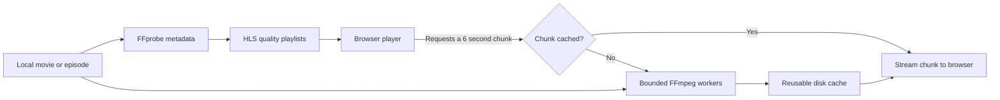

# Yoru — your own little anime cinema

A self-hosted anime streaming site. Fork it, run it on your PC, point it at your movie and series folder, and watch in a browser. Videos stay on the host PC. Viewers press play; there is no download or import step on the viewing device.

Yoru includes a responsive library, search, movie/series filters, genres, watchlist, resume playback, seasons, next episode, subtitles, and **adaptive HLS streaming for slower connections**. The interface, fonts, and artwork work without external services after installation. No anime files or online content providers are bundled.

## Run it

Install **Node.js 22.13+ (24 recommended)** and **FFmpeg**, including `ffprobe`. Both FFmpeg tools must be on your PATH. Then, from your fork or clone:

```bash
git clone https://github.com/dawitlabs/anime-local.git
cd anime-local
npm ci
cp .env.example .env
# Put your videos in media/, or edit MEDIA_DIR in .env.
npm run build
npm start
```

Open **http://localhost:4173**. Click **Manage library** for folder instructions and **Refresh library** after adding files. On Windows, copy `.env.example` to `.env` in Explorer or use `Copy-Item .env.example .env` in PowerShell. The Node server and FFmpeg calls do not require Bash.

For development: `npm run dev`. The API and Vite use the same port.

### Docker

Docker includes Node and FFmpeg:

```bash
docker compose up --build -d
```

Open http://localhost:4173. The media folder is mounted read-only; generated streaming chunks live in a separate named volume. Set `MEDIA_DIR` in `.env` before starting to mount a different host folder. Docker Desktop must be allowed to access it. Use `docker compose down` to stop.

### Watch on another device

For Node, set `HOST=0.0.0.0` in `.env` and restart. For Docker, set `BIND_ADDRESS=0.0.0.0` in `.env` and recreate the container. Open `http://YOUR-PC-LAN-IP:4173` on your phone, tablet, or TV browser on the same network. The host PC must stay on. This is a personal server with no login system; for access outside a trusted home network, put an authenticated VPN or HTTPS authentication proxy in front of it. Do not forward the port publicly without authentication.

Anyone can fork this MIT-licensed repository and run an independent library. Forking shares the source code, not anyone’s media or watch history.

## Organize your collection

```text
media/
├── Movies/
│   └── My Anime Movie/
│       ├── movie.mkv
│       ├── movie.en.srt
│       ├── poster.jpg
│       ├── backdrop.jpg
│       └── title.json
└── Series/
    └── My Anime Series/
        ├── poster.webp
        ├── title.json
        ├── Season 01/
        │   ├── S01E01 - The Beginning.mp4
        │   ├── S01E01 - The Beginning.en.vtt
        │   └── S01E02 - A New Journey.mp4
        └── Season 02/
            └── S02E01 - Homecoming.mkv
```

- Recognized video containers: MP4, M4V, WebM, MKV, MOV, OGV. Adaptive playback converts FFmpeg-readable video to H.264/AAC while streaming; original-quality playback depends on browser codec support.
- `Movies/` and `Series/` are recommended. Top-level title folders also work; multiple videos, season folders, or `S01E01` names identify a series. Put alternate cuts of a movie in separate title folders.
- Loose video files become individual movies. For a loose `Film.mp4`, use `Film.json`, `Film.poster.jpg`, and `Film.backdrop.jpg` beside it.
- Series are ordered by season and episode number, then naturally by filename. Use `S01E01` names for reliable ordering.
- Optional artwork: `poster.jpg` / `backdrop.jpg` (also PNG, JPEG, WebP). Without artwork, Yoru creates a local illustrated cover.
- Optional UTF-8 `.srt` / `.vtt` subtitles: match the video basename, optionally followed by a language code. For example, `S01E01.en.srt`. Select captions using the browser player. Embedded MKV subtitles and alternate audio selection are not extracted; adaptive playback uses the first video/audio tracks. Extract a subtitle with FFmpeg if needed.
- Hidden files and symbolic links are skipped. Use real folders, or configure `MEDIA_DIR` as the root of the collection.
- An empty installation honestly shows an empty library. No fake playable titles are seeded.

Example `title.json` inside a title’s folder:

```json
{
  "title": "My Anime Series",
  "description": "A journey through a world of quiet wonders.",
  "year": 2026,
  "genres": ["Adventure", "Fantasy"]
}
```

Watchlist and playback progress are saved per browser in local storage. They are not shared across devices and are removed if browser data is cleared.

## How streaming works



This uses the same core adaptive-bitrate idea as large video sites, scaled to a personal PC:

1. FFprobe reads duration and dimensions; the server builds complete VOD playlists so you can seek anywhere immediately.
2. The player starts at the smallest quality, estimates throughput, and changes quality as the connection allows. Choose **240p · Data saver** to keep it low.
3. The server seeks into the source and encodes **only the requested six-second segment and quality**. It does not convert an entire movie before playing or produce every quality in advance.
4. Concurrent requests for the same segment share one encoding task. Other viewers and future plays reuse the cached result.
5. Two bounded encoding workers run by default, each with limited codec threads; the waiting queue is capped. Chunk files are written atomically. Old cached chunks are evicted to keep the completed cache under 512 MiB by default; in-progress temporary chunks need a small amount of additional disk space. Active responses are protected from eviction.
6. The player keeps a short forward buffer (18 seconds target, 24 seconds maximum) and six seconds of back buffer. hls.js is loaded only when opening the player. Safari can use native HLS, whose buffering is managed by the browser.

| Quality | Target video + audio bitrate | Approximate data per hour before container overhead |
| ------- | ---------------------------- | --------------------------------------------------- |
| 240p    | 200 + 40 kbps                | 108 MB                                              |
| 360p    | 400 + 48 kbps                | 202 MB                                              |
| 720p    | 1,300 + 64 kbps              | 614 MB                                              |

These are encoding targets, not measured guarantees. Audio is omitted when absent. Source video is never upscaled. Quality options above the source height are omitted. Each chunk starts at a keyframe and has an explicit HLS discontinuity because it is encoded independently. This makes random seeking independent of previous chunks. It trades a little transition/encoding overhead for simple bounded storage and instant access to any point in the source.

The first uncached chunk needs encoding time. A weak CPU or connection below the lowest stream bitrate can still buffer. More concurrent viewers also need more host upload bandwidth; this is not a CDN. Original quality uses HTTP byte-range streaming without encoding. There is no offline-download feature, though all browser streaming necessarily transfers video bytes.

Implementation references: [FFmpeg HLS documentation](https://ffmpeg.org/ffmpeg-formats.html#hls-2), [hls.js API](https://github.com/video-dev/hls.js/blob/master/docs/API.md), and [browser container support](https://developer.mozilla.org/en-US/docs/Web/Media/Guides/Formats/Containers).

## Configuration

Copy `.env.example` to `.env`; restart after changes.

| Variable            | Default            | Purpose                                                       |
| ------------------- | ------------------ | ------------------------------------------------------------- |
| `MEDIA_DIR`         | `./media`          | Your local media root; relative to the repository or absolute |
| `HOST`              | `127.0.0.1`        | Node listen address; `0.0.0.0` enables trusted LAN access     |
| `PORT`              | `4173`             | HTTP port                                                     |
| `CACHE_DIR`         | `./.cache/streams` | Dedicated generated-chunk directory                           |
| `CACHE_MAX_MB`      | `512`              | Completed segment cache budget in MiB, minimum 32             |
| `TRANSCODE_WORKERS` | `2`                | Parallel segment encoders, from 1 to 4                        |
| `BIND_ADDRESS`      | `127.0.0.1`        | Docker host binding only                                      |

Do not put `CACHE_DIR` inside `MEDIA_DIR`, and use a dedicated cache directory per running instance. Stop the app before manually clearing its cache. Media, secrets, cache, and build artifacts are excluded from Git. The server reads source media; it does not modify or delete source videos.

If original playback cannot handle a file and you want a permanent compatible copy:

```bash
npm run convert -- "/path/input.mkv" "/path/output.mp4"
```

This optional command keeps the input and refuses to overwrite an existing output. It selects the first video/audio tracks. Normal adaptive playback does not require manual conversion.

## Development and checks

```bash
npm run dev
npm run check
npm test
npm run build
```

Tests include real FFmpeg encoding and require FFmpeg/FFprobe. They cover media discovery, seasons, subtitles, invalid metadata, path isolation, HTTP seeking, HLS quality playlists, arbitrary segment requests, and shared chunk caching. CI runs tests and the production build.

The frontend is React + TypeScript + Vite. The Node/Express server owns library discovery, file streaming, subtitles, and FFmpeg scheduling. There is no database or cloud service to provision. Only stream media you have permission to use.

MIT licensed. Forks and contributions welcome.
