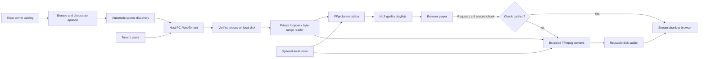

# Yoru — your own little anime cinema

A self-hosted anime streaming site with **automatic discovery and torrent streaming on your PC**. Fork it, run it, browse or search for an anime, and press **Watch**. Yoru loads the episode list, finds a source, and begins streaming before the complete video has arrived. **No magnet link, torrent file, or API key is required for the normal workflow.**

Each person runs an independent host. The browser is the player; the PC discovers torrent peers and serves adaptive video. Yoru includes movies, series, popular/trending/top-rated catalogs, genre filters, a watchlist, resume playback, seasons, next episode, and **240p/360p/720p adaptive HLS for slower viewer connections**. Local videos and manual torrent sources remain optional advanced features.

The catalog is live metadata, not a bundled collection of anime files. Availability depends on the discovery providers and reachable peers. Some titles or episodes have no usable source; Yoru reports that and offers a retry. It cannot guarantee every anime or instant startup.

## Run it

Install **Node.js 22.13+ (24 recommended)** and **FFmpeg**, including `ffprobe`. Both FFmpeg tools must be on your PATH. Then, from your fork or clone:

```bash
git clone https://github.com/dawitlabs/anime-local.git
cd anime-local
npm ci
cp .env.example .env
npm run build
npm start
```

Open **http://localhost:4173**. Anime appears automatically, including on a fresh installation with an empty media folder. Search for a title, open its card, and choose an episode. Yoru selects the source on the host PC; the player shows connection and buffering progress. **Try another stream** switches to another candidate while retaining watch progress.

**Stream settings** contains optional manual source input, peer/speed information, and pause/remove controls. You do not need to enter anything there to use Discover. Sources and cached pieces survive restarts.

On Windows, copy `.env.example` to `.env` in Explorer or use `Copy-Item .env.example .env` in PowerShell. The Node server and FFmpeg calls do not require Bash.

For development: `npm run dev`. The API and Vite use the same port.

### Docker

Docker includes Node and FFmpeg:

```bash
docker compose up --build -d
```

Open http://localhost:4173. Torrent metadata and pieces persist in the `torrent-data` volume; generated HLS chunks use the separate `stream-cache` volume. The optional local media folder is mounted read-only. Use `docker compose down` to stop without deleting those volumes. Docker uses outbound peer connections without automatically opening router ports.

### Watch on another device

For Node, set `HOST=0.0.0.0` in `.env` and restart. For Docker, set `BIND_ADDRESS=0.0.0.0` in `.env` and recreate the container. Open `http://YOUR-PC-LAN-IP:4173` on your phone, tablet, or TV browser on the same network. The host PC must stay on. This is a personal server with no login system; for access outside a trusted home network, put an authenticated VPN or HTTPS authentication proxy in front of it. Do not forward the port publicly without authentication.

Anyone can fork this MIT-licensed repository and run an independent library. Forking shares the source code, not anyone’s media or watch history.

## Automatic catalog and source discovery

The defaults use the [Kitsu anime add-on](https://github.com/TheBeastLT/stremio-kitsu-anime) for titles, search, artwork and episode metadata, and [Torrentio](https://github.com/TheBeastLT/torrentio-scraper) for torrent candidates. No account or API key is needed with these public defaults. You can set `CATALOG_URL` and `SOURCES_URL` to compatible add-on base URLs on your own host. The providers must support `anime` resources and Kitsu IDs; a manifest URL is accepted too. A general movie-only provider is not a drop-in replacement.

Catalog and source responses are bounded, cached for five minutes, and shared between simultaneous requests. Provider failures remain visible and retryable. Only selecting Play contacts torrent peers; browsing does not download episodes. Sources with reported peers, lower resolution, and smaller per-video size are preferred. Automatic discovery considers videos up to 3 GiB and tries up to four candidates, checking the selected filename/index against actual torrent metadata. It does not blindly play the first file in a season pack. A failed newly added candidate is removed; an already available source is preserved.

Catalog/search and episode requests go from your PC to the configured providers. Artwork loads from their HTTPS image hosts. Fonts, scripts, the player, and video are served by your PC. Providers are independent services and can change, rate-limit, or become unavailable. A slow or cold swarm can take a minute or more to start. Use **On this PC** for existing local sources when catalog services are unavailable.

## Torrent behavior and bandwidth

- Adding a source retrieves its metadata but does **not** select the whole torrent for download. Reads select pieces in 512 KiB windows, with backpressure and cancellation when the viewer seeks or closes a stream. Torrent piece boundaries and socket buffering mean some neighboring bytes can also be fetched.
- The PC keeps verified pieces on disk and shares them with peers. Upload is limited to 128 KiB/s by default. Pause disconnects the source; resume rechecks cached pieces. Remove deletes that source's torrent cache. Generated HLS chunks expire separately under their cache budget.
- Up to 32 sources can be added. Their **combined declared full size** must fit `TORRENT_MAX_GB` (20 GiB by default), even if only a few pieces are present. This is an admission budget, not an LRU piece cache; remove old sources to free capacity. Allow extra space for HLS chunks, metadata and filesystem overhead.
- Movies and multi-episode torrents work. Files are ordered naturally; `S01E01` names give reliable season/episode ordering. A multi-video torrent is shown as one series. BitTorrent v1 hashes are supported; v2-only torrents and archived videos inside RAR/ZIP are not.
- A source must have reachable peers with the required pieces. Zero-seed torrents can stall. Torrent source quality matters: picking a 480p release generally needs less incoming bandwidth than a 1080p release of the same show.
- **Data saver reduces PC → browser traffic. It cannot reduce the original bytes the PC needs from torrent peers.** Watching on the same PC primarily saves player bandwidth/decoding, not your internet quota; automatic discovery prefers smaller sources to help reduce incoming internet use, but cannot promise a particular torrent bitrate.
- Streaming still transfers and caches bytes. There is no separate full-file download step or offline-download button. Nothing can guarantee instant playback or a universal anime catalog.

## Optional local video library

Existing files can be added without torrenting: use **Local files** in the sidebar, put videos in `media/` (or set `MEDIA_DIR`), then **Refresh library**.

```text
media/
├── Movies/
│   └── My Anime Movie/
│       ├── movie.mkv
│       ├── movie.en.srt
│       ├── poster.jpg
│       ├── backdrop.jpg
│       └── title.json
└── Series/
    └── My Anime Series/
        ├── poster.webp
        ├── title.json
        ├── Season 01/
        │   ├── S01E01 - The Beginning.mp4
        │   ├── S01E01 - The Beginning.en.vtt
        │   └── S01E02 - A New Journey.mp4
        └── Season 02/
            └── S02E01 - Homecoming.mkv
```

- Recognized video containers: MP4, M4V, WebM, MKV, MOV, OGV. Adaptive playback converts FFmpeg-readable video to H.264/AAC while streaming; original-quality playback depends on browser codec support.
- `Movies/` and `Series/` are recommended. Top-level title folders also work; multiple videos, season folders, or `S01E01` names identify a series. Put alternate cuts of a movie in separate title folders.
- Loose video files become individual movies. For a loose `Film.mp4`, use `Film.json`, `Film.poster.jpg`, and `Film.backdrop.jpg` beside it.
- Series are ordered by season and episode number, then naturally by filename. Use `S01E01` names for reliable ordering.
- Optional artwork: `poster.jpg` / `backdrop.jpg` (also PNG, JPEG, WebP). Without artwork, Yoru creates a local illustrated cover.
- Optional UTF-8 `.srt` / `.vtt` subtitles: match the video basename, optionally followed by a language code. For example, `S01E01.en.srt`. Select captions using the browser player. Embedded MKV subtitles and alternate audio selection are not extracted; adaptive playback uses the first video/audio tracks. Extract a subtitle with FFmpeg if needed.
- Hidden files and symbolic links are skipped. Use real folders, or configure `MEDIA_DIR` as the root of the collection.
- An empty local media folder is fine: Discover uses the online anime catalog. On this PC lists only actual files and sources on this host.

Example `title.json` inside a title’s folder:

```json
{
  "title": "My Anime Series",
  "description": "A journey through a world of quiet wonders.",
  "year": 2026,
  "genres": ["Adventure", "Fantasy"]
}
```

Watchlist and playback progress are saved per browser in local storage. They are not shared across devices and are removed if browser data is cleared.

## How streaming works



This uses the same core adaptive-bitrate idea as large video sites, scaled to a personal PC:

1. The server looks up the chosen episode and selects a matching torrent candidate. WebTorrent obtains metadata and discovers peers on the host PC. A secret loopback-only HTTP reader makes selected torrent bytes available to FFmpeg without waiting for a complete file. HTTP metadata URLs and web seeds from magnets are disabled.
2. FFprobe reads duration and dimensions; the server builds complete VOD playlists. Seeking selects pieces near the requested position; it may wait for peers and container indexes.
3. The player starts at the smallest quality, estimates throughput, and changes quality as the connection allows. Choose **240p · Data saver** to keep it low.
4. The server seeks into the source and encodes **only the requested six-second segment and quality**. It does not convert an entire movie before playing or produce every quality in advance.
5. Concurrent requests for the same segment share one encoding task. Other viewers and future plays reuse the cached result.
6. Two bounded encoding workers run by default, each with limited codec threads; the waiting queue is capped. Chunk files are written atomically. Old cached chunks are evicted to keep the completed cache under 512 MiB by default; in-progress temporary chunks need a small amount of additional disk space. Active responses are protected from eviction.
7. The player keeps a short forward buffer (18 seconds target, 24 seconds maximum) and six seconds of back buffer. hls.js is loaded only when opening the player. Safari can use native HLS, whose buffering is managed by the browser.

| Quality | Target video + audio bitrate | Approximate data per hour before container overhead |
| ------- | ---------------------------- | --------------------------------------------------- |
| 240p    | 200 + 40 kbps                | 108 MB                                              |
| 360p    | 400 + 48 kbps                | 202 MB                                              |
| 720p    | 1,300 + 64 kbps              | 614 MB                                              |

These are encoding targets for the **host-to-viewer connection**, not measured guarantees or torrent download rates. Audio is omitted when absent. Source video is never upscaled. Quality options above the source height are omitted. Each chunk starts at a keyframe and has an explicit HLS discontinuity because it is encoded independently. Random seeking does not require encoding preceding chunks, but does require fetching the relevant source pieces.

The first uncached chunk needs encoding time. A weak CPU or connection below the lowest stream bitrate can still buffer. More concurrent viewers also need more host upload bandwidth; this is not a CDN. Original quality uses HTTP byte-range streaming without encoding. There is no offline-download feature, though all browser streaming necessarily transfers video bytes.

Implementation references: [WebTorrent API](https://webtorrent.io/docs), [FFmpeg HLS documentation](https://ffmpeg.org/ffmpeg-formats.html#hls-2), [hls.js API](https://github.com/video-dev/hls.js/blob/master/docs/API.md), and [browser container support](https://developer.mozilla.org/en-US/docs/Web/Media/Guides/Formats/Containers).

## Configuration

Copy `.env.example` to `.env`; restart after changes.

| Variable            | Default                         | Purpose                                                                     |
| ------------------- | ------------------------------- | --------------------------------------------------------------------------- |
| `CATALOG_URL`       | `https://anime-kitsu.strem.fun` | Compatible Kitsu anime metadata/catalog add-on                              |
| `SOURCES_URL`       | `https://torrentio.strem.fun`   | Compatible Kitsu anime torrent discovery add-on                             |
| `MEDIA_DIR`         | `./media`                       | Your local media root; relative to the repository or absolute               |
| `HOST`              | `127.0.0.1`                     | Node listen address; `0.0.0.0` enables trusted LAN access                   |
| `PORT`              | `4173`                          | HTTP port                                                                   |
| `CACHE_DIR`         | `./.cache/streams`              | Dedicated generated-chunk directory                                         |
| `CACHE_MAX_MB`      | `512`                           | Completed segment cache budget in MiB, minimum 32                           |
| `TRANSCODE_WORKERS` | `2`                             | Parallel segment encoders, from 1 to 4                                      |
| `TORRENT_DIR`       | `./data/torrents`               | Private metadata and torrent piece storage                                  |
| `TORRENT_MAX_GB`    | `20`                            | Combined declared source-size budget in GiB                                 |
| `ALLOWED_HOSTS`     | empty                           | Extra hostnames, comma-separated; localhost and numeric IPs work by default |
| `BIND_ADDRESS`      | `127.0.0.1`                     | Docker host binding only                                                    |

Keep `CACHE_DIR`, `TORRENT_DIR`, and `MEDIA_DIR` separate. Use dedicated storage directories per running instance. Stop the app before manually clearing its cache. Media, torrent metadata (which may contain private tracker URLs), secrets, cache, and build artifacts are excluded from Git. Local library files are read-only; **Remove source and cache** only deletes the app's torrent pieces for that source.

If original playback cannot handle a file and you want a permanent compatible copy:

```bash
npm run convert -- "/path/input.mkv" "/path/output.mp4"
```

This optional command keeps the input and refuses to overwrite an existing output. It selects the first video/audio tracks. Normal adaptive playback does not require manual conversion.

## Development and checks

```bash
npm run dev
npm run check
npm test
npm run build
```

Tests include real FFmpeg encoding and a **private, loopback-only two-client torrent swarm** using generated video. They verify empty-host catalog browsing, automatic discovery through real torrent-backed HLS without manual input, candidate fallback, file identity, shared requests, retriable provider failures, magnet metadata, torrent-file import, playback before the full video arrives, unselected files staying unselected, byte ranges, transcoding from torrent pieces, persistence, pause/resume, removal, and the existing local-media paths. Tests do not contact public trackers or download anime. CI runs formatting, tests, and the production build.

Linux/Chrome is exercised locally. Live public catalog/search, automatic torrent playback, seeking, resume, and next-episode playback have also been checked in Chrome; a 390px mobile viewport was checked for layout overflow. Cold peer discovery/probing can exceed a minute. Windows/macOS, mobile Safari, and large multi-user loads need separate validation. Public swarm availability varies over time. Embedded subtitle tracks and alternate audio selection remain unsupported; local sidecar SRT/VTT captions are supported. See [SECURITY.md](SECURITY.md) for deployment boundaries and the current dependency advisory assessment.

The frontend is React + TypeScript + Vite. The Node/Express server owns WebTorrent, library discovery, file streaming, subtitles, and FFmpeg scheduling. There is no database or cloud service to provision. Only stream media you have permission to use.

MIT licensed. Forks and contributions welcome.
